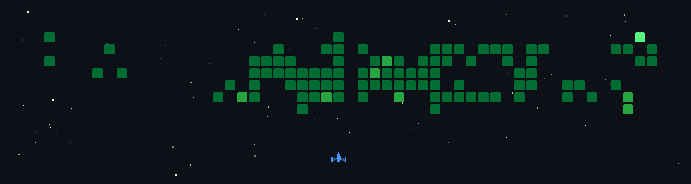

# Hi, I'm Solitude_ZY 👋

> **让模型真正跑起来——最好跑在摄像头后面那块巴掌大的板子上。**

智能科学与技术 · 计算机视觉 / 边缘端部署 / 多模态大模型应用

我做的东西大多指向同一件事：**把"看得懂"的模型，塞进"用得起"的设备里。** 从数据准备、训练、量化、拆头，到板端拉流推理和告警上报，这条链路我自己走通，也自己在工地上被它坑过。

---

## 🔭 我在做什么

| 方向 | 具体在折腾什么 |
| --- | --- |
| **边端视觉巡检** | 滑坡、交通锥、防护装备、桥梁裂缝——检测 / 分割 / 跨帧追踪，最后压成 INT8 上 RK3576 |
| **多模态大模型落地** | Qwen-VL 两阶段微调（工程安全场景）、自动标注流水线、切片推理、MQTT 服务化 |
| **Agent 与桌面端应用** | 文档生成、舆情监测、通用桌面 Agent——Electron / Tauri / FastAPI 一条龙 |
| **云-端协同工程化** | 设备管理、固件升级、任务下发，云端和板端怎么把话说清楚 |

---

## 🧩 精选项目

### 边端视觉巡检

| 项目 | 说明 |
| --- | --- |
| [**UAV_cone**](https://github.com/SolitudeZY/UAV_cone) | 无人机视角的交通导改锥桶检测：YOLOv8s-OBB 三分类 + MobileNetV3 候选审核，输出锥桶**移位 / 缺失 / 倒伏**告警 |
| [**landslide-detect**](https://github.com/SolitudeZY/landslide-detect) | 滑坡检测与跨帧追踪，YOLOv8 检测 + 时序迟滞抑制误报，含 RK3576 端侧部署链路 |
| [**rk3576-edge-platform**](https://github.com/SolitudeZY/rk3576-edge-platform) | 板端平台：RTSP 拉流 → RKNN INT8 推理 → YOLO 拆头后处理 → 推流与预览 |
| [**CrackNet**](https://github.com/SolitudeZY/CrackNet) | 桥梁裂缝语义分割：DeepLab + ResNet101 与 U²-Net 双路线，含裂缝宽度量测 |
| [**PPE_Drone**](https://github.com/SolitudeZY/PPE_Drone) | 无人机视角的防护装备识别，YOLO / RT-DETR 对比 |

### 大模型与 Agent 应用

| 项目 | 说明 |
| --- | --- |
| [**QuickModel**](https://github.com/SolitudeZY/QuickModel) ⭐41 | 通用桌面 Agent：把便宜模型用在日常，把强模型留给硬活 |
| [**OpinionLens**](https://github.com/SolitudeZY/OpinionLens) ⭐38 | 舆见：社媒舆情监测与 AI 报告桌面端（Electron + FastAPI + MediaCrawler） |
| [**qwen_fine_tuning**](https://github.com/SolitudeZY/qwen_fine_tuning) | Qwen-VL 两阶段微调：先 grounding 再结构化 JSON，识别边防护/基坑围挡等违规场景 |
| [**Free-Agent**](https://github.com/SolitudeZY/Free-Agent) | 基于 DeepAgent 的 Web 端文档生成：标书撰写、自动化报表 |
| [**qwen-redetect**](https://github.com/SolitudeZY/qwen-redetect) | Qwen-VL 视频/图像识别复核服务，Go API + 内置 Web 复核台 |

### 平台与工具

| 项目 | 说明 |
| --- | --- |
| [**AIhander**](https://github.com/SolitudeZY/AIhander) | 云-端协同 AI 设备管理平台：cloud 控制台 + agent 固件升级 + Detector 边端检测器 |
| [**Free_Train**](https://github.com/SolitudeZY/Free_Train) | Tauri + Rust 写的本地离线视觉数据预处理工具：抽帧、切图、质检、去重、可追溯导出 |
| [**MTD-ISC**](https://github.com/SolitudeZY/MTD-ISC) | 恶意流量检测平台 |
| [**Detection_Platform**](https://github.com/SolitudeZY/Detection_Platform) | 基于 Django 的检测管理 Web 应用 |
| [**ADCAE**](https://github.com/SolitudeZY/ADCAE) | 非对称深度卷积自编码器复现 |

---

## 🛠 技术栈

| 层次 | 用到的技术 |
| --- | --- |
| **模型与训练** | PyTorch · Ultralytics YOLO · RT-DETR · DeepLabv3+ · U²-Net · MobileNetV3 |
| **端侧部署** | RKNN-Toolkit2 · RK3576 · ONNX · INT8 量化 · RTSP / MediaMTX |
| **大模型** | Qwen-VL · LoRA / DeepSpeed · flash-attn |
| **工程** | Python · Go · Rust · FastAPI · Svelte · Electron · Tauri · Docker · MQTT |

---

## 📊 一点数据

- **24** 个原创仓库（不含 fork）
- [**QuickModel**](https://github.com/SolitudeZY/QuickModel) **41★** 与 [**OpinionLens**](https://github.com/SolitudeZY/OpinionLens) **38★**，是目前关注度最高的两个仓库
- **4** 类视觉任务在端侧跑通过：目标检测、语义分割、旋转框（OBB）、跨帧追踪
- **1** 条完整链路：`数据准备 → 训练 → ONNX → INT8 量化 → 拆头 → RK3576 推理 → 告警上报`

---

## 📫 联系我

- 📧 邮箱：[q2205773452@163.com](mailto:q2205773452@163.com) / [xztszy@gmail.com](mailto:xztszy@gmail.com)
- 💬 想聊：边端视觉部署、YOLO 后处理、VLM 微调、或者你也在这条链路上被坑过

**Only by remaining humble can we reach the top of the mountain.**
